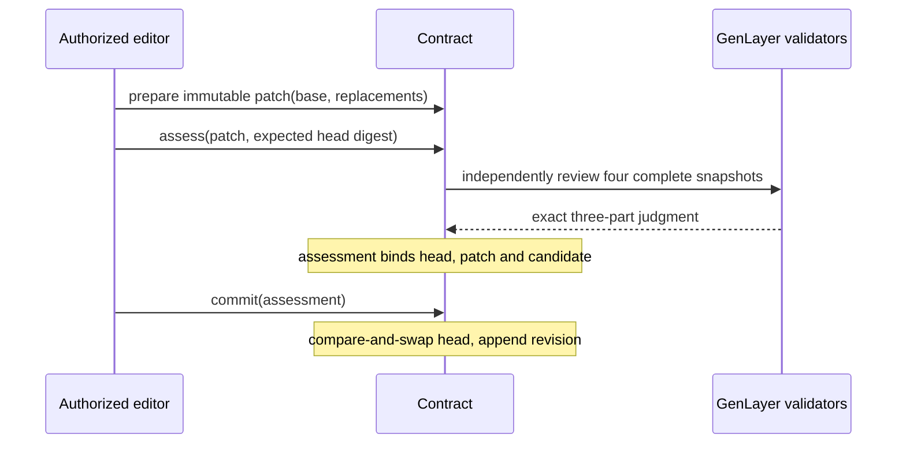

# Semantic Rebase

**Merge exact editor changes while checking the meaning of concurrent revisions.**

A text merge can succeed even when its result is wrong. One editor changes a workshop from online to in-person. Another editor working from the old snapshot adds “join the online link; do not travel.” These edits touch different sections, yet their combination contradicts the event format.

Semantic Rebase is a standalone GenLayer document concurrency primitive. Editors submit immutable section replacements. Consensus reviews four complete snapshots: base, author-intended, current and candidate. Only a safe assessment may advance the head, and only while its expected version still matches.

## The merge path



The model never writes merged prose. Candidate bytes come only from current sections and editor replacements. Same-section concurrent changes are rejected deterministically before any model call. Every remaining candidate requires independent checks of:

1. **Patch intent:** the author's original change retains its meaning on the new base.
2. **Concurrent intent:** already committed changes retain their meaning.
3. **Coherence:** no contradictory obligations or broken references.

Every check must be PRESERVED. CONFLICT and UNKNOWN cannot authorize a merge. Exact agreement binds all three fields; there is no confidence tolerance or severity tier.

## A judgment has a version

Assessment records the reviewed head and exact candidate without editing the document. Commit rechecks the head, immutable patch digest, open status and expiry before appending one hash-linked revision. Any concurrent commit makes a prior assessment stale, even when it was SAFE. Reassessment is required.

Editors are fixed at creation. Only editors prepare patches and request assessments, protecting bounded history from outsiders. Commit is permissionless because its caller cannot alter the assessed text. Author or owner may cancel; anyone may close an expired patch.

Initial document creation records owner input without semantic certification. The model evaluates document meaning rather than independently verifying real-world facts. All text is public; no assets are held.

## Inspect and reproduce

| Resource | Inspect |
|---|---|
| [Contract](contracts/semantic_rebase.py) | Exact composition and transactional commit |
| [Protocol](docs/PROTOCOL.md) | Storage, lifecycle, races and API |
| [Consensus](docs/CONSENSUS.md) | Four-snapshot evidence and exact boundary |
| [Security](docs/SECURITY.md) | Editor trust and semantic limits |
| [Live walkthrough](docs/LIVE_VALIDATION.md) | Real network branch outcomes |
| [Tests](tests/test_semantic_rebase.py) | Version races, conflicts, expiry and validators |
| [Deployment](deployment.json) | Address, receipt and matching source hashes |

```bash
python -m pip install -r requirements.txt
# PowerShell: $env:GENVM_VERSION='v0.2.12'
# POSIX: export GENVM_VERSION=v0.2.12
genvm-lint check contracts/semantic_rebase.py --json
python -m pytest -q
npm ci --ignore-scripts
npm run verify
```

The suite explicitly executes validators and checks all 27 three-field judgment combinations. Live execution demonstrates a hidden cross-section conflict and an independent safe rebase; it does not prove correctness for every possible document.

Read-only `npm run verify` re-fetches source and receipts. `npm run smoke` deploys a fresh gasless StudioNet demo using ephemeral keys. Python 3.12, Node.js 22+, concrete pinned GenVM v0.2.12 runner. MIT licensed.
